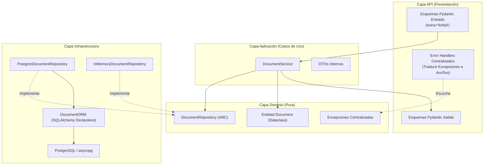

# Propuesta de Diseño Técnico: Microservicio `persistence` (v1.0)

> **Documento:** `docs/FASE1_DISENO.md`  
> **Estado:** Propuesta de Diseño - Revisión 2  
> **Responsabilidad:** Microservicio `persistence`

---

## 1. Alcance de `persistence`

El microservicio `persistence` tiene como responsabilidad exclusiva **persistir de forma durable, garantizar la integridad mediante unicidad estricta y permitir la consulta del texto extraído de documentos PDF y sus metadatos asociados**.

No procesa binarios de PDF, no realiza OCR, no extrae texto y no orquesta servicios externos. Quien interactúa primariamente con este microservicio es el **orquestador**.

| Operación | Estado | Justificación técnica y de negocio |
| :--- | :---: | :--- |
| **Guardar documento** (`POST /documents`) | **Necesaria** | Operación nuclear. Almacena de forma atómica el texto extraído y metadatos suministrados por el orquestador. |
| **Consultar por ID** (`GET /documents/{id}`) | **Necesaria** | Permite al frontend u orquestador recuperar el documento y texto completo por su UUID. |
| **Consultar por checksum** (`GET /documents/by-checksum/{checksum}`) | **Necesaria** | Permite verificar si un archivo ya fue extraído previamente para evitar re-extracciones costosas. |
| **Listar con paginación** (`GET /documents`) | **Necesaria** | Permite al frontend consultar el historial de documentos de forma paginada y determinista sin transferir el texto completo. |
| **Actualizar metadatos** (`PATCH /documents/{id}`) | **A confirmar con el equipo (Recomendado: diferir a v1.1)** | El texto extraído y el checksum provienen de un archivo inmutable. Para el MVP el flujo es WORM (*write once, read many*). La edición de metadatos secundarios no bloquea la extracción y agrega complejidad innecesaria en la v1. |
| **Eliminar documento** (`DELETE /documents/{id}`) | **A confirmar con el equipo** *(Recomendación: Hard delete en v1; Soft delete si se exige auditoría)* | Permite cumplir con requerimientos de privacidad/limpieza. Se debe acordar si el borrado libera el checksum para admitir re-subida del mismo archivo. |
| **Health checks** (`GET /health/live`, `GET /health/ready`) | **Necesaria** | Vitales para Kubernetes / Docker Compose / Traefik. Separan la vivacidad del proceso (`live`) de la conectividad efectiva a la base de datos (`ready`). |

---

## 2. Modelo de datos mínimo

Entidad conceptual: **`Document`**

| Campo | Tipo | Requerido | Justificación y restricciones |
| :--- | :--- | :---: | :--- |
| `id` | `UUID` (v4, string) | **Sí** | Identificador único universal, generado por el microservicio al persistir. Independiente de la base de datos. |
| `checksum_sha256` | `str` (64 hex chars) | **Sí** | Hash SHA-256 del archivo PDF original. Restricción `UNIQUE` en base de datos para garantizar unicidad e idempotencia atómica. |
| `extracted_text` | `str` (texto arbitrario) | **Sí** | Contenido textual extraído. Puede ser vacío (si el PDF no contenía texto legible) o de varios megabytes. |
| `filename` | `str` (máx. 255 chars) | **Sí** | Nombre original del archivo (ej. `reporte_2026.pdf`). |
| `file_size_bytes` | `int` (>= 0) | **Opcional** | Tamaño en bytes del archivo original provisto por el orquestador. |
| `page_count` | `int` (>= 0) | **Opcional** | Cantidad de páginas del PDF provisto por el extractor/orquestador. |
| `created_at` | `datetime` (UTC) | **Sí** | Marca temporal de creación. Inmutable. |
| `updated_at` | `datetime` (UTC) | **Sí** | Marca temporal de última actualización. |
| `metadata` | `dict` / `JSONB` | **Opcional** | Metadatos abiertos adicionales (ej. autor, versión del extractor, tiempo de proceso). Default `{}`. |

---

## 3. Elección de base de datos y estrategia de esquema

### Base de datos: PostgreSQL 16
Se aprueba el uso de **PostgreSQL 16** con driver asíncrono **`asyncpg`** y **`SQLAlchemy 2.0`**:
- **Textos de gran volumen:** El mecanismo nativo TOAST de PostgreSQL comprime y almacena fuera de la página principal campos de tipo `TEXT` de hasta 1 GB sin penalizar lecturas de metadatos. Evita el límite rígido de 16 MB por documento de MongoDB.
- **Unicidad e integridad ACID:** La restricción `UNIQUE` en `checksum_sha256` se evalúa a nivel motor con isolation levels estándar, eliminando condiciones de carrera.
- **Metadatos semiestructurados:** El tipo `JSONB` permite indexar y consultar metadatos variables sin perder estructura relacional.
- **Despliegue liviano:** La imagen oficial `postgres:16-alpine` pesa ~80 MB frente a los ~700 MB de MongoDB.

### Creación del esquema: `create_all` vs `Alembic`

| Criterio | `Base.metadata.create_all` al iniciar | `Alembic` (Migraciones versionadas) |
| :--- | :--- | :--- |
| **Complejidad inicial** | Mínima (una línea en el startup / lifespan). | Requiere inicializar entorno (`alembic.ini`, `env.py`) y crear scripts de migración. |
| **Evolución del esquema** | **Nula**: Si una columna, tipo o índice cambia en producción, `create_all` no altera tablas existentes; falla silenciosamente. | **Total**: Registra historial incremental de cambios (`upgrade`, `downgrade`), versionado en Git. |
| **Seguridad en producción** | Riesgoso en entornos multi-réplica (condición de carrera de DDL si varias instancias arrancan a la vez). | Desacopla la migración de DDL del arranque del servidor (se corre como job previo en CI/CD). |
| **Uso en tests** | Práctico para inicializar bases efímeras en tests. | Puede ejecutarse programáticamente (`command.upgrade(config, 'head')`) garantizando paridad con prod. |

**Recomendación de ingeniería:**  
Usar **`Alembic`** como mecanismo oficial de gestión y migración de esquema.
- Las tablas se crean y modifican exclusivamente mediante scripts de migración versionados.
- En los tests de integración con `testcontainers`, la fixture ejecuta `alembic upgrade head` para asegurar que las migraciones son 100% reproducibles y no existen divergencias entre el ORM y la base de datos real.

---

## 4. Duplicados e idempotencia

### Garantía atómica
- **Nivel Base de Datos:** Se define una restricción única formal:
  ```sql
  CONSTRAINT uq_documents_checksum_sha256 UNIQUE (checksum_sha256)
  ```
- **Concurrencia:** Dos solicitudes concurrentes con el mismo checksum causarán que la segunda transacción sea abortada por el motor de base de datos con un error de violación de unicidad (`asyncpg.exceptions.UniqueViolationError` / `sqlalchemy.exc.IntegrityError`).
- **Mapeo en Repositorio:** El repositorio captura exclusivamente dicha excepción y lanza la excepción de dominio `DocumentAlreadyExistsError(checksum=..., existing_id=...)`.

### Respuesta ante duplicados
- **Status HTTP:** **`409 Conflict`**.
- **Cuerpo estructurado:** Provee el `existing_id` y el checksum en conflicto.
- No se incluye ningún header de idempotencia ad-hoc (`X-Idempotent-Mode`). La semántica REST se mantiene pura:
```json
{
  "error": {
    "code": "DOCUMENT_ALREADY_EXISTS",
    "message": "A document with the provided checksum already exists.",
    "details": {
      "checksum": "e3b0c44298fc1c149afbf4c8996fb92427ae41e4649b934ca495991b7852b855",
      "existing_id": "9b1deb4d-3b7d-4bad-9bdd-2b0d7b3dcb6d"
    },
    "request_id": "f47ac10b-58cc-4372-a567-0e02b2c3d479",
    "timestamp": "2026-10-19T20:00:00Z"
  }
}
```
Esto permite al orquestador decidir si reutiliza el documento existente o informa al usuario del duplicado.

---

## 5. Contratos HTTP v1

### Formato uniforme de error
Todos los endpoints de la API (a excepción de `/health/ready`, que es de infraestructura operativa) responden el siguiente formato único ante errores:
```json
{
  "error": {
    "code": "STRING_IDENTIFIER",
    "message": "Descripción comprensible del error",
    "details": {},
    "request_id": "f47ac10b-58cc-4372-a567-0e02b2c3d479",
    "timestamp": "2026-10-19T20:00:00Z"
  }
}
```

### Manejo centralizado de validación (422)
FastAPI por defecto emite `422` con formato nativo ante `RequestValidationError`.
- Se **sobrescribe** el handler global de `RequestValidationError` para mapear cualquier error de validación (esquema Pydantic, parámetros de query o path, payload JSON no deserializable) al formato uniforme con código HTTP **`422 Unprocessable Entity`** y `code: "VALIDATION_ERROR"`.
- Se elimina el error `400 INVALID_REQUEST_BODY`. Un request con formato o tipos inválidos responde invariablemente `422`.
- Todos los esquemas de entrada usan `model_config = ConfigDict(extra="forbid")`, por lo que enviar campos desconocidos o intentar inyectar campos inmutables dispara inmediatamente un error `422`.

---

### Catálogo de Endpoints

#### 1. Crear documento
- **Ruta:** `POST /api/v1/documents`
- **Request Body:**
```json
{
  "checksum_sha256": "e3b0c44298fc1c149afbf4c8996fb92427ae41e4649b934ca495991b7852b855",
  "filename": "informe_financiero.pdf",
  "extracted_text": "Texto extraído del documento...",
  "page_count": 12,
  "file_size_bytes": 1048576,
  "metadata": {
    "author": "Departamento Contable"
  }
}
```
- **Response `201 Created`** (Header `Location: /api/v1/documents/9b1deb4d-3b7d-4bad-9bdd-2b0d7b3dcb6d`):
```json
{
  "id": "9b1deb4d-3b7d-4bad-9bdd-2b0d7b3dcb6d",
  "checksum_sha256": "e3b0c44298fc1c149afbf4c8996fb92427ae41e4649b934ca495991b7852b855",
  "filename": "informe_financiero.pdf",
  "extracted_text": "Texto extraído del documento...",
  "page_count": 12,
  "file_size_bytes": 1048576,
  "metadata": {
    "author": "Departamento Contable"
  },
  "created_at": "2026-10-19T20:00:00Z",
  "updated_at": "2026-10-19T20:00:00Z"
}
```
- **Respuestas de error:**
  - `409 Conflict` (`DOCUMENT_ALREADY_EXISTS`): Checksum duplicado.
  - `413 Payload Too Large` (`PAYLOAD_TOO_LARGE`): Si el cuerpo de la petición excede el límite máximo permitido (ej. 25 MB).
  - `422 Unprocessable Entity` (`VALIDATION_ERROR`): Faltan campos obligatorios, campos desconocidos (`extra="forbid"`), o tipos inválidos.

#### 2. Consultar documento por ID
- **Ruta:** `GET /api/v1/documents/{id}`
- **Response `200 OK`:** Mismo JSON que en creación.
- **Respuestas de error:**
  - `404 Not Found` (`DOCUMENT_NOT_FOUND`).
  - `422 Unprocessable Entity` (`VALIDATION_ERROR`): Si el `{id}` no es un UUID válido.

#### 3. Consultar documento por Checksum
- **Ruta:** `GET /api/v1/documents/by-checksum/{checksum_sha256}`
- **Response `200 OK`:** Mismo JSON que en creación.
- **Respuestas de error:**
  - `404 Not Found` (`DOCUMENT_NOT_FOUND`).
  - `422 Unprocessable Entity` (`VALIDATION_ERROR`): Si el checksum no tiene exactamente 64 caracteres hexadecimales.

#### 4. Listar documentos (Paginación determinista)
- **Ruta:** `GET /api/v1/documents?skip=0&limit=20`
- **Query Params:**
  - `skip`: int >= 0 (default: 0).
  - `limit`: int entre 1 y 100 (default: 20, max: 100).
- **Orden determinista:**
  `ORDER BY created_at DESC, id ASC`  
  (Los documentos más recientes aparecen primero; `id ASC` actúa como criterio estricto de desempate para evitar duplicados u omisiones en paginación por desplazamiento).
- **Response `200 OK`:**  
  *(Nota: Los ítems de la lista proyectan `DocumentSummaryResponse` excluyendo `extracted_text` para optimizar red y memoria)*.
```json
{
  "items": [
    {
      "id": "9b1deb4d-3b7d-4bad-9bdd-2b0d7b3dcb6d",
      "checksum_sha256": "e3b0c44298fc1c149afbf4c8996fb92427ae41e4649b934ca495991b7852b855",
      "filename": "informe_financiero.pdf",
      "page_count": 12,
      "file_size_bytes": 1048576,
      "created_at": "2026-10-19T20:00:00Z",
      "updated_at": "2026-10-19T20:00:00Z"
    }
  ],
  "total": 145,
  "skip": 0,
  "limit": 20
}
```
- **Respuestas de error:**
  - `422 Unprocessable Entity` (`VALIDATION_ERROR`): `skip < 0` o `limit < 1` o `limit > 100`.

#### 5. Actualizar metadatos (A confirmar, recomendado diferir a v1.1)
- **Ruta:** `PATCH /api/v1/documents/{id}`
- **Semántica:** Actualización parcial exclusivamente de metadatos mutables (`filename`, `metadata`). Inmutables: `id`, `checksum_sha256`, `extracted_text`, `created_at`.
- **Semántica de `metadata`:** **Shallow merge (fusión de primer nivel)**. Las claves enviadas en `metadata` se agregan o sobrescriben sobre el objeto existente; las claves omitidas se conservan intactas; enviar una clave con valor `null` elimina dicha clave.
- **Configuración de esquema:** `extra="forbid"`. Intentar enviar `extracted_text` o cualquier campo inmutable produce error `422`.
- **Request Body:**
```json
{
  "filename": "informe_financiero_final.pdf",
  "metadata": {
    "reviewed": true,
    "obsolete_key": null
  }
}
```
- **Response `200 OK`:** Documento actualizado completo.
- **Respuestas de error:**
  - `404 Not Found` (`DOCUMENT_NOT_FOUND`).
  - `422 Unprocessable Entity` (`VALIDATION_ERROR`): Campo desconocido o inmutable enviado.

#### 6. Eliminar documento
- **Ruta:** `DELETE /api/v1/documents/{id}`
- **Response `204 No Content`** (sin cuerpo).
- **Respuestas de error:**
  - `404 Not Found` (`DOCUMENT_NOT_FOUND`).
  - `422 Unprocessable Entity` (`VALIDATION_ERROR`): ID inválido.

#### 7. Healthchecks (Excepción al formato de error)
Los endpoints operativos `/health/live` y `/health/ready` son la **única excepción al formato uniforme de error**, respetando el formato plano convencional para orquestadores y balanceadores de carga:
- **`GET /health/live` (Liveness):**
  - Response `200 OK`: `{"status": "alive"}`
- **`GET /health/ready` (Readiness):**
  - Valida ejecución de consulta rápida en base de datos (`SELECT 1`).
  - Response `200 OK`: `{"status": "ready", "database": "connected"}`
  - Response `503 Service Unavailable`: `{"status": "unhealthy", "database": "disconnected"}`

---

## 6. Arquitectura por capas y mapeo de modelos



### Dónde vive cada modelo y su flujo de mapeo

1. **Entidad de Dominio (`app/domain/models.py` - `Document`):**
   - Implementada como `dataclass` pura de Python.
   - Representa el concepto de negocio y sus invariantes.
   - Completamente agnóstica a la base de datos y al framework web (cero imports de SQLAlchemy o FastAPI).

2. **Esquemas de la API (`app/api/schemas.py` - Pydantic v2):**
   - Entrada: `DocumentCreateRequest`, `DocumentUpdateRequest` (con `extra="forbid"`).
   - Salida: `DocumentResponse` (completo), `DocumentSummaryResponse` (sin texto, para listado), `ErrorEnvelope`.
   - **Mapeo:** La capa API transforma `DocumentCreateRequest` a los parámetros/DTOs que consume el servicio de aplicación, y serializa la Entidad `Document` retornada por el servicio mediante `DocumentResponse.from_entity(doc)`.

3. **Modelo ORM (`app/infrastructure/database/models.py` - `DocumentORM`):**
   - Clase SQLAlchemy derivada de `DeclarativeBase`. Vive **exclusivamente** en la capa de infraestructura.
   - Define la tabla `documents`, tipos específicos (`UUID`, `Text`, `JSONB`, `DateTime(timezone=True)`), índices y restricciones únicas.
   - **Mapeo:** El repositorio concreto (`PostgresDocumentRepository`) es el **único** componente del sistema que conoce a `DocumentORM`. Realiza la conversión bidireccional:
     - `_to_orm(entity: Document) -> DocumentORM`
     - `_to_entity(orm: DocumentORM) -> Document`
   - El dominio y la aplicación nunca reciben ni manejan instancias del ORM.

### Única fuente de excepciones (`app/domain/exceptions.py`)
Todas las excepciones del sistema residen en un solo archivo:
- `DocumentNotFoundError(document_id: str)`
- `DocumentAlreadyExistsError(checksum: str, existing_id: str)`
- `PersistenceInfrastructureError(message: str)`
En `app/api/error_handlers.py` se configuran los manejadores de FastAPI que traducen cada una de estas excepciones al código HTTP correspondiente y al cuerpo uniforme con `request_id`.

---

## 7. Librerías requeridas y justificación

Para dar estricto cumplimiento a la regla de no incorporar librerías sin justificar, se detalla el conjunto completo propuesto para aprobación:

### Dependencias de Runtime (`dependencies`)

| Librería | Versión mín. | Justificación técnica |
| :--- | :---: | :--- |
| **`fastapi`** | `>=0.115` | Framework web ASGI de alto rendimiento, soporte nativo de inyección de dependencias y OpenAPI. |
| **`uvicorn[standard]`** | `>=0.30` | Servidor ASGI estándar de producción con soporte de uvloop y httptools para servir la API. |
| **`pydantic`** | `>=2.9` | Validación estricta de esquemas, parsing de JSON y serialización robusta. |
| **`pydantic-settings`** | `>=2.5` | Carga tipada de configuración desde variables de entorno y archivos `.env` sin hardcodear secretos. |
| **`sqlalchemy[asyncio]`** | `>=2.0` | Abstracción de acceso a datos y pool de conexiones asíncrono con sintaxis 2.0. |
| **`asyncpg`** | `>=0.29` | Driver asíncrono de PostgreSQL de mayor rendimiento en Python para operaciones no bloqueantes. |
| **`alembic`** | `>=1.13` | Herramienta de migraciones de base de datos para evolución versionada y reproducible del esquema. |

### Dependencias de Desarrollo y Pruebas (`dev-dependencies`)

| Librería | Versión mín. | Justificación técnica |
| :--- | :---: | :--- |
| **`pytest`** | `>=8.3` | Framework estándar para orquestación y ejecución de la suite de pruebas. |
| **`pytest-asyncio`** | `>=0.24` | Plugin imprescindible para ejecutar fixtures y casos de prueba asíncronos (`async def test_*`). |
| **`httpx`** | `>=0.27` | Cliente HTTP asíncrono requerido por FastAPI para ejecutar pruebas de integración HTTP con `AsyncClient`. |
| **`testcontainers[postgres]`** | `>=4.8` | Gestión programática de contenedores Postgres efímeros para tests de integración reales. Solo en dev. Marcados con `@pytest.mark.integration` y programados para saltarse si Docker no está activo en el entorno. |
| **`ruff`** | `>=0.6` | Linter y formateador ultrarrápido para asegurar Clean Code, reglas PEP8 y prevenir errores estáticos. |

---

## 8. Estrategia de pruebas (TDD)

### Categorías de pruebas
1. **Unitarias (`tests/unit`):** Prueban el dominio y `DocumentService` usando `InMemoryDocumentRepository`. Corren en memoria en milisegundos.
2. **Contrato de Repositorio (`tests/contract`):** Suite abstracta `BaseDocumentRepositoryContractTest` que se ejecuta tanto contra `InMemoryDocumentRepository` como contra `PostgresDocumentRepository`. Garantiza paridad estricta entre ambas implementaciones.
3. **Integración con Base Real (`tests/integration`):**
   - Utilizan `testcontainers[postgres]`.
   - Se marcan con `@pytest.mark.integration`.
   - **Regla de salto:** Si el demonio de Docker no está en ejecución, se omiten limpiamente con `pytest.skip("Docker not available")` sin romper el build local.
4. **Pruebas HTTP (`tests/http`):** Prueban rutas completas usando `httpx.AsyncClient` sobreescribiendo el repositorio por la versión en memoria.

### Comandos de ejecución con `uv`
```bash
# Tests rápidos (unitarios, HTTP y contrato en memoria, sin Docker)
uv run pytest -m "not integration"

# Tests unitarios puros
uv run pytest tests/unit

# Tests de contrato en memoria
uv run pytest tests/contract/test_memory_repository.py

# Tests de endpoints HTTP
uv run pytest tests/http

# Tests de integración contra base de datos real (requiere Docker activo)
uv run pytest -m "integration"
```

---

## 9. Preparación operativa futura

1. **Docker y multi-stage build:** Dockerfile ligero en multi-stage, sin permisos de root (`USER appuser`), empaquetado solo con dependencias de runtime.
2. **Traefik:** Rutas con prefijo `/api/v1` preparadas para enrutamiento reverso y monitoreo continuo en `/health/ready`.
3. **Logs Estructurados y Seguridad:** Formato JSON. Prohibido estrictamente loguear `extracted_text`, tokens o credenciales. Se registran únicamente: `request_id`, `document_id`, `checksum_sha256`, `filename`, `text_size_chars: len(extracted_text)`.
4. **Trazabilidad (`X-Request-ID`):** Middleware que intercepta o genera un `request_id` (UUID v4), lo propaga en el header de respuesta `X-Request-ID`, lo inyecta en el contexto de logs y lo adjunta en todas las respuestas uniformes de error.
5. **Apagado Seguro (Graceful Shutdown):** En el lifespan de FastAPI, al recibir `SIGTERM`, se cierra el pool de conexiones de SQLAlchemy (`await engine.dispose()`).

---

## 10. Decisiones a acordar con el equipo

| # | Decisión para el equipo (Orquestador / Extractor / Frontend) | Recomendación por defecto de `persistence` |
| :-: | :--- | :--- |
| **1** | **¿Quién calcula el checksum SHA-256 del PDF y cómo llega a `persistence`?** | El **extractor** calcula el SHA-256 del binario al procesarlo y se lo devuelve al **orquestador**. El **orquestador** es quien invoca a `persistence` enviando `checksum_sha256` en el payload de creación. `persistence` no recibe binarios, pero asegura la unicidad estricta en base de datos. |
| **2** | **¿Quién genera el `id` del documento?** | **`persistence`** genera el identificador canónico (`UUID v4`) en la inserción y lo retorna en la respuesta `201 Created`. |
| **3** | **¿Qué metadatos exactos consolida el orquestador para enviar a `persistence`?** | El **orquestador** recopila los datos del archivo original (`filename`, `file_size_bytes`) y los resultados de la extracción (`extracted_text`, `page_count`) y los envía en una única llamada `POST /api/v1/documents`. Metadatos no disponibles se envían como `null` o se omiten. |
| **4** | **¿Cómo reacciona el orquestador ante `409 Conflict`?** | `persistence` devuelve `409 Conflict` con el `existing_id`. El **orquestador** decide si reutiliza el documento existente (notificando éxito al frontend) o si avisa al usuario que el documento ya existía. |
| **5** | **¿Inmutabilidad del texto extraído?** | El texto extraído es **estrictamente inmutable**. Si se requiere reprocesar con otro motor de extracción, se evaluará como reemplazo explícito o versionado en v2. |
| **6** | **¿Borrado físico vs lógico?** | **Hard delete** (físico) en la v1. Si el equipo requiere auditoría o trazabilidad histórica, se implementará soft-delete (`deleted_at`) en v1.1. |
| **7** | **Límite de tamaño de payload de texto** | Establecer un límite máximo de **25 MB** por petición en `persistence` (`413 Payload Too Large`). Si un PDF genera más texto, el orquestador debe seccionarlo o acordar compresión. |
| **8** | **Versionado de la API** | Versionado en ruta: `/api/v1`. |
| **9** | **Formato de timestamps** | **ISO 8601 en UTC** con sufijo `Z` (`YYYY-MM-DDTHH:MM:SSZ`). |

---

Esperando aprobación para la Fase 2
